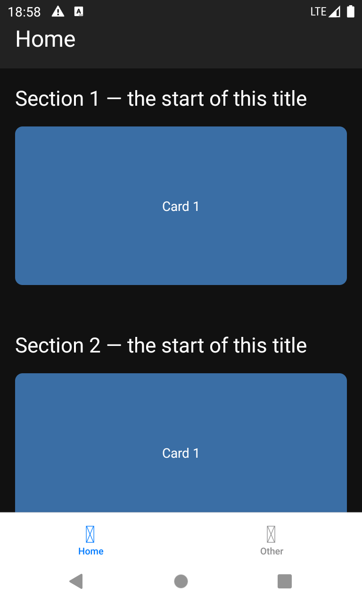
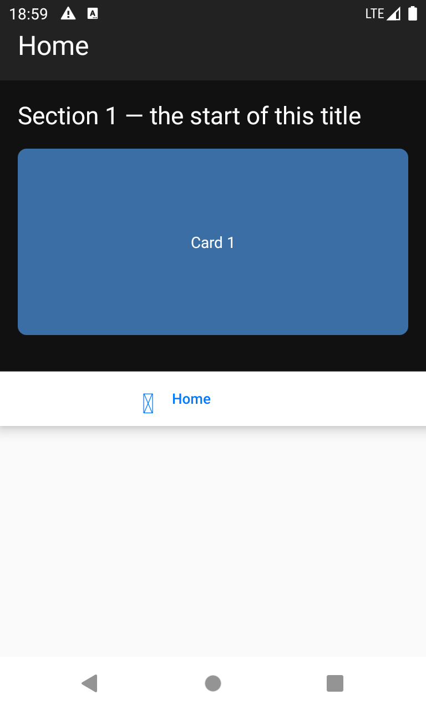
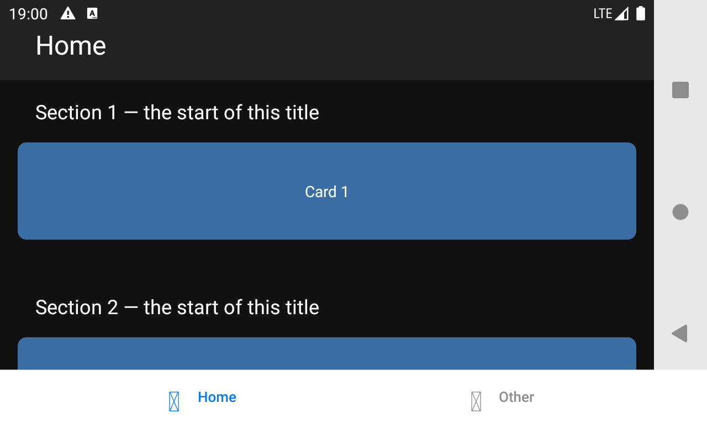
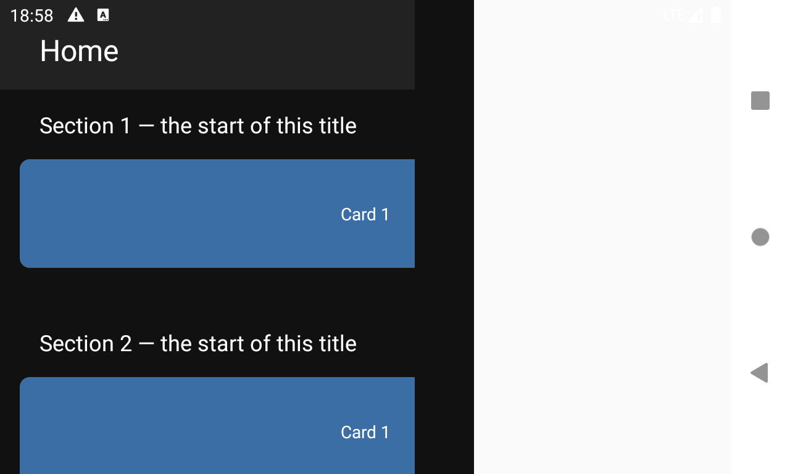

# Unistyles Android rotation repro

On Android, from react-native-unistyles 3.5.3 on, rotating the device sometimes leaves the whole app laid out for the previous orientation. It stays that way until the next rotation. iOS isn't affected, and 3.5.2 and earlier don't do it.

| Portrait, OK | Portrait after a rotation, stuck in landscape |
|---|---|
|  |  |

| Landscape, OK | Landscape after a rotation, stuck in portrait |
|---|---|
|  |  |

In the broken state, only the part of the screen matching the old orientation's size has content. The bottom tab bar keeps the old width too, and it isn't styled with Unistyles. So it looks like React Native's root view keeps its previous size, not just that some Unistyles styles go stale.

## The app

[`src/App.tsx`](src/App.tsx) is a bottom tab navigator ([React Navigation](https://reactnavigation.org)). The Home tab has:

- a header with `paddingTop: rt.insets.top` and landscape/portrait paddings;
- a vertical `LegendList` of sections;
- in each section, a title with landscape/portrait styles and a horizontal carousel whose page width comes from `withUnistyles` (`rt.screen.width`).

Unistyles runs through its Babel plugin (`root: 'src'`).

- Expo SDK 57, React Native 0.86.3, New Architecture, edge-to-edge
- react-native-unistyles 3.6.0, react-native-nitro-modules 0.37.1
- @legendapp/list 3.7.0, @react-navigation/bottom-tabs 7, react-native-screens 4.26

## Reproduce

```sh
npm install
npx expo run:android
```

Then rotate the device back and forth. On an emulator, `scripts/rotate.sh` does this for you: it rotates 40 times through `adb` and saves a screenshot after each rotation into `screenshots/run/`.

```sh
scripts/rotate.sh
```

On a Nexus 4 emulator running API 30, roughly 1 rotation in 4 to 6 ends in the broken state.

## Narrowing it down

40 rotations per build on the same emulator. Each broken layout was still broken 5 s later.

| react-native-unistyles | Broken rotations |
|---|---|
| 3.3.0 (Nitro 0.35.4) | 0 / 40 |
| 3.4.0 | 0 / 40 |
| 3.5.0 | 0 / 40 |
| 3.5.2 | 0 / 40 |
| **3.5.3** | **7 / 40** |
| 3.6.0 | 11 / 40 |
| 3.6.0, Activity configuration listener from #1294 removed | 6 / 40 |
| 3.6.0, both Android Kotlin files restored to 3.5.2 (all of #1294 undone) | 9 / 40 |

From 3.4.0 on, every build uses Nitro 0.37.1.

The regression is in 3.5.3, but not in its Android-specific change (#1294). The remaining 3.5.3 changes are shared by both platforms. The likeliest one is #1298, which reworked how Unistyles commits its updates to the shadow tree, for example by tracking committed views by instance handle instead of tag. That's a guess: it hasn't been confirmed by reverting #1298 alone.
